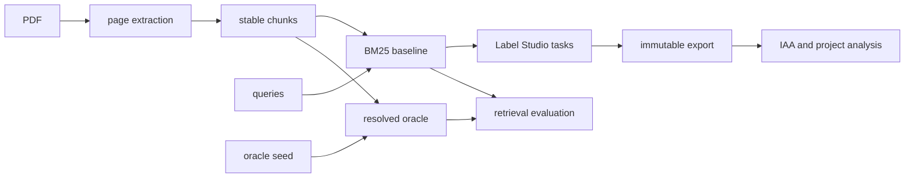

# Architecture and data lineage

The workbench separates ground truth, candidate generation, and annotation. This is the key design decision: a retrieval system must never read the oracle file used to score it.

Each run lives at `workspace/<document-id>/<pipeline-version>/`. The document ID comes from the PDF SHA-256; the chunk ID contains the page, sequence, and content hash. `manifest.json` records the parser, split settings, page count, chunk count, and pages that probably need OCR. `pages.jsonl` is the searchable page layer. `chunks.jsonl` is the only input to retrieval.

Candidate tasks retain `query_id`, `candidate_id`, `document_id`, `chunk_id`, page, score, rank, and exact displayed text. The Label Studio export therefore joins back to the immutable run without guessing. Store every export under a versioned name such as `exports/retrieval-2026-10-13-v1.json`; adjudication should create a new artifact rather than editing the original.

The CLI runs synchronously and writes local files. The API exposes the same operations for a trusted local environment. A production path should upload by bytes, queue a job, store originals and versioned artifacts in object storage, keep status in a database, isolate parsers, and restrict document access by project.

## ML backend boundary

Tasks can be labeled without live inference because they already contain ranked candidates. The optional Label Studio ML backend adds Presidio spans and model-assisted predictions at annotation time. `DocumentEvalBackend.predict()` is the Label Studio entry point; it delegates multimodal inference to `ResponsesClient`, while `PresidioClient` detects spans and supplies redacted text unless `MODEL_SEND_PII=true`. The client uses the official OpenAI SDK and only its Responses API; configuration selects OpenAI directly or a LiteLLM proxy. Keep OCR, embeddings, and full-document indexing in explicit offline jobs so an annotator request stays bounded. See [the backend guide](ml-backend.md).
