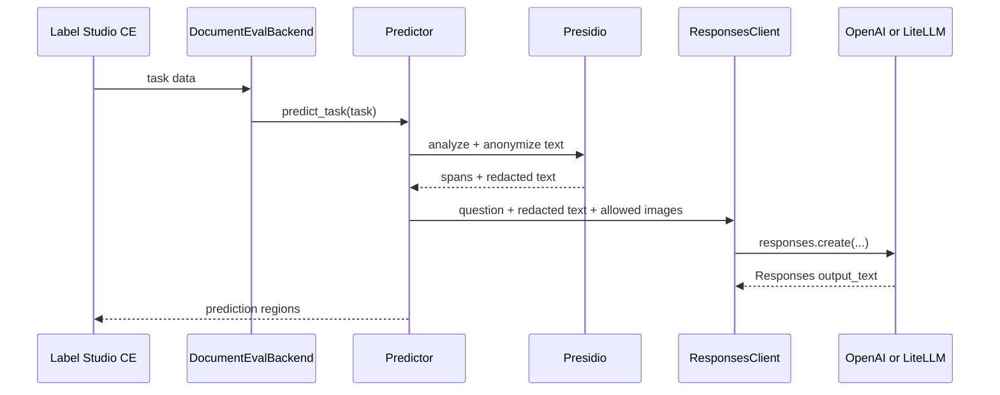

# Label Studio, multimodal Responses, and Presidio

## Request path



`model.py` implements the Label Studio ML protocol. `Predictor` coordinates privacy and inference. `PresidioClient` labels PII spans and returns redacted text. `ResponsesClient.classify_relevance()` is the only element that calls a model: it uses the official OpenAI Python SDK's `client.responses.create()` method with `input_text` and optional `input_image` content. Completions and Chat Completions are not used.

The SDK client takes a configurable `base_url`. This keeps one request implementation for both providers:

- `MODEL_PROVIDER=openai` calls OpenAI directly at `https://api.openai.com/v1`.
- `MODEL_PROVIDER=litellm` calls a separately operated LiteLLM proxy, defaulting to `http://host.docker.internal:4000/v1` from the container.

LiteLLM is not a Python dependency of this service. It is an optional gateway that exposes an OpenAI-compatible `/responses` endpoint and owns its provider credentials, routing, budgets, and model aliases. The backend only needs the `openai` SDK.

## Configure a provider

Copy `.env.example` to `.env`. Direct OpenAI access needs only:

```dotenv
MODEL_API_KEY=<project-key>
MODEL_BASE_URL=https://api.openai.com/v1
```

Providing the key enables inference automatically. The default model is `gpt-6-luna`, and image forwarding is enabled for quick multimodal tests. Set `MODEL_NAME` or `MODEL_SEND_IMAGES=false` when you need different behavior.

For a LiteLLM proxy:

```dotenv
MODEL_ENABLED=true
MODEL_PROVIDER=litellm
MODEL_BASE_URL=http://host.docker.internal:4000/v1
MODEL_NAME=document-vision
LITELLM_API_KEY=<proxy-virtual-key>
```

Here `document-vision` can be a LiteLLM model alias. Change the alias mapping in LiteLLM to move between hosted or private providers without rebuilding this backend. You can also change `MODEL_NAME` per environment. The selected upstream must support the Responses API and image input if tasks include images.

Start the stack, then connect Label Studio to the backend URL:

```bash
docker compose up --build -d
```

Open `http://localhost:8080`, then use **Settings → Model → Connect Model** with `http://ml-backend:9090`. The backend's `fit()` deliberately does not retrain; export annotations and run the offline evaluation workflow instead.

## Send text and images

Use `label_studio/multimodal_retrieval.xml` and import tasks shaped like this:

```json
{
  "data": {
    "task_type": "retrieval",
    "question": "Does this page identify the contracting parties?",
    "text": "Optional extracted page text",
    "image": "https://example.org/page-1.png"
  }
}
```

`image` accepts one URL. `images` accepts a list; both may be present, duplicates are removed, and `MODEL_MAX_IMAGES` caps the request. A value may also be `{"image_url": "..."}`. OpenAI supports fully qualified image URLs and base64 data URLs. A cloud model cannot reach Label Studio's container-local upload path, so provide an externally reachable URL or a data URL. The backend does not download or transform images.

Image forwarding is enabled in the quick-test defaults. Its advanced settings are:

```dotenv
MODEL_SEND_IMAGES=true
MODEL_IMAGE_DETAIL=auto
MODEL_MAX_IMAGES=4
```

Supported detail values are `auto`, `low`, `high`, and `original`; actual support depends on the chosen upstream model.

## PII behavior

Presidio analyzes the original `text` field. For PII tasks, its offsets become Label Studio regions against that original string. The analyzer result is then sent to Presidio Anonymizer with the `replace` operator. Retrieval inference receives redacted text by default; set `MODEL_SEND_PII=true` only when policy permits sending the original text. `PII_FAIL_CLOSED=true` stops inference if Presidio is unavailable.

Image pixels do not pass through Presidio. The lean OpenAI smoke-test configuration forwards images, so set `MODEL_SEND_IMAGES=false` before working with unredacted sensitive scans. Remove or mask visual PII with a document-image redaction step and test the output. OCR plus Presidio can locate candidate text, but irreversible visual redaction also needs page coordinates and rendered-image masking. Presidio remains probabilistic, so evaluate custom recognizers for languages and identifiers in your documents.

## Environment reference

| Variable | Purpose | Default |
|---|---|---|
| `MODEL_ENABLED` | Permit model calls; `auto` enables them when a key exists | `auto` |
| `MODEL_PROVIDER` | `openai` or `litellm` | `openai` |
| `MODEL_BASE_URL` | Override the selected provider's API root | provider default |
| `MODEL_NAME` | OpenAI model ID or LiteLLM model alias | `gpt-6-luna` |
| `OPENAI_API_KEY` | Direct OpenAI project key | empty |
| `LITELLM_API_KEY` | LiteLLM proxy or virtual key | empty |
| `MODEL_API_KEY` | Provider-neutral override for either key | empty |
| `MODEL_TIMEOUT_SECONDS` | Per-request timeout | `20` |
| `MODEL_MAX_OUTPUT_TOKENS` | Response token cap | `128` |
| `MODEL_TEMPERATURE` | Optional sampling temperature | provider default |
| `MODEL_SEND_PII` | Send original rather than redacted text | `false` |
| `MODEL_SEND_IMAGES` | Forward task images unchanged | `true` |
| `MODEL_IMAGE_DETAIL` | Image preprocessing detail | `auto` |
| `MODEL_MAX_IMAGES` | Maximum images per request | `4` |
| `PRESIDIO_ENABLED` | Analyze and redact task text | `true` |
| `PRESIDIO_LANGUAGE` | Recognizer language | `en` |
| `PRESIDIO_SCORE_THRESHOLD` | Minimum detection score | `0.5` |
| `PRESIDIO_TIMEOUT_SECONDS` | Presidio request timeout | `10` |
| `PII_FAIL_CLOSED` | Block inference when redaction fails | `true` |

The request sets `store=false`, bounds output tokens, and treats task content as untrusted data in its instructions. Keep provider keys out of task data and logs. The synchronous backend is suitable for evaluation and assisted labeling; production workloads still need concurrency limits, retries, audit logs without payloads, and a reviewed retention policy.

References: [OpenAI image inputs with the Responses API](https://developers.openai.com/api/docs/guides/images-vision) and [LiteLLM supported endpoints](https://docs.litellm.ai/docs/supported_endpoints).
